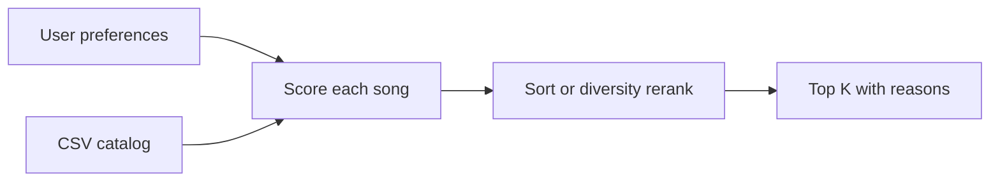

# VibeFinder 1.0 — Music Recommender Simulation

A CLI-first educational content-based music recommender with transparent scores.

## How The System Works

Spotify and YouTube can combine collaborative filtering (patterns in similar users' likes, skips, playlists and viewing history) with content-based filtering (song genre, tempo, mood and energy). This simulation uses only content-based filtering: it does not learn from other listeners. Energy proximity is more useful than simply rewarding high energy because a chill listener wants a low target. Genre and mood describe taste, while acousticness helps distinguish sound texture.

Song fields: ID, title, artist, genre, mood, energy, tempo, valence, danceability, acousticness, popularity, release decade, mood tag, duration and language. All 20 rows are synthetic; the last ten broaden the catalog. UserProfile stores favorite genre, favorite mood, target energy and acoustic preference. Dictionary profiles can additionally specify all five advanced features.

Algorithm recipe: exact genre +2, exact mood +1, energy similarity max(0, 1 - absolute energy gap), acoustic preference +0.5 times acousticness (or its complement). Optional advanced preferences each contribute up to 0.5: exact mood tag and language, and proximity for popularity (scale 100), release decade (50 years), duration (300 seconds). Missing preferences add no points. Tempo, valence and danceability are descriptive only. Default core maximum is 4.5; all advanced preferences can raise it to 7.0.



Scoring judges one candidate; ranking compares all candidates. Python sorted returns a new list, while list.sort mutates its list. Genre dominance can create a filter bubble.

## Getting Started

From the repository root, use Python 3.9 or newer.

```bash
python -m venv .venv
pip install -r requirements.txt
python -m src.main
```

Activate the virtual environment first if using one (macOS/Linux: source .venv/bin/activate; Windows: .venv\Scripts\activate).

```bash
python -m src.main --profile "High-Energy Pop" --mode mood-first
python -m src.main --profile Advanced --diversity
python -m src.main --profile "High-Energy Pop" --experiment
python -m pytest
```

Modes (genre, mood, energy): balanced (2,1,1), genre-first (3,1,1), mood-first (1,3,1), energy-focused (1,1,2). Diversity greedily subtracts 0.75 per previously selected same artist and 0.25 per same genre; this is a soft penalty, not a hard cap. Tables show adjusted scores and reasons.

## Sample Recommendation Output

The following tables match the actual Python output captured in an isolated notebook runtime from hash-verified source and data at commit 70ee38d. Loaded songs: 20. Balanced mode; diversity off.

### High-Energy Pop

```text
Rank | Song             | Artist        | Score | Reasons
-----+------------------+---------------+-------+----------------------------------------------------------------------------------------------------
1    | Sunrise City     | Neon Echo     | 4.390 | genre match (+2.000); mood match (+1.000); energy similarity (+0.980); acoustic preference (+0.410)
2    | Gym Hero         | Max Pulse     | 3.345 | genre match (+2.000); energy similarity (+0.870); acoustic preference (+0.475)
3    | Bittersweet Rush | Neon Echo     | 3.320 | genre match (+2.000); energy similarity (+0.920); acoustic preference (+0.400)
4    | Accra Sunrise    | Kora Wave     | 2.390 | mood match (+1.000); energy similarity (+0.950); acoustic preference (+0.440)
5    | Rooftop Lights   | Indigo Parade | 2.285 | mood match (+1.000); energy similarity (+0.960); acoustic preference (+0.325)
```

### Chill Lofi

```text
Rank | Song               | Artist         | Score | Reasons
-----+--------------------+----------------+-------+----------------------------------------------------------------------------------------------------
1    | Ocean Lanterns     | LoRoom         | 4.390 | genre match (+2.000); mood match (+1.000); energy similarity (+0.980); acoustic preference (+0.410)
2    | Library Rain       | Paper Lanterns | 4.380 | genre match (+2.000); mood match (+1.000); energy similarity (+0.950); acoustic preference (+0.430)
3    | Midnight Coding    | LoRoom         | 4.335 | genre match (+2.000); mood match (+1.000); energy similarity (+0.980); acoustic preference (+0.355)
4    | Focus Flow         | LoRoom         | 3.390 | genre match (+2.000); energy similarity (+1.000); acoustic preference (+0.390)
5    | Spacewalk Thoughts | Orbit Bloom    | 2.340 | mood match (+1.000); energy similarity (+0.880); acoustic preference (+0.460)
```

### Deep Intense Rock

```text
Rank | Song             | Artist     | Score | Reasons
-----+------------------+------------+-------+----------------------------------------------------------------------------------------------------
1    | Storm Runner     | Voltline   | 4.440 | genre match (+2.000); mood match (+1.000); energy similarity (+0.990); acoustic preference (+0.450)
2    | Gym Hero         | Max Pulse  | 2.445 | mood match (+1.000); energy similarity (+0.970); acoustic preference (+0.475)
3    | Electric Horizon | Prism Sky  | 1.425 | energy similarity (+0.940); acoustic preference (+0.485)
4    | Velvet Thunder   | Iron Coast | 1.410 | energy similarity (+0.920); acoustic preference (+0.490)
5    | Accra Sunrise    | Kora Wave  | 1.390 | energy similarity (+0.950); acoustic preference (+0.440)
```

### Conflicting Preferences

```text
Rank | Song             | Artist    | Score | Reasons
-----+------------------+-----------+-------+----------------------------------------------------------------------------------------------------
1    | Bittersweet Rush | Neon Echo | 4.380 | genre match (+2.000); mood match (+1.000); energy similarity (+0.980); acoustic preference (+0.400)
2    | Gym Hero         | Max Pulse | 3.445 | genre match (+2.000); energy similarity (+0.970); acoustic preference (+0.475)
3    | Sunrise City     | Neon Echo | 3.330 | genre match (+2.000); energy similarity (+0.920); acoustic preference (+0.410)
4    | Quiet Letters    | June Keys | 1.500 | mood match (+1.000); energy similarity (+0.400); acoustic preference (+0.100)
5    | Storm Runner     | Voltline  | 1.440 | energy similarity (+0.990); acoustic preference (+0.450)
```

## Experiments You Tried

Halve genre weight and double energy weight for High-Energy Pop:

```text
Rank | Song             | Artist        | Score | Reasons
-----+------------------+---------------+-------+----------------------------------------------------------------------------------------------------
1    | Sunrise City     | Neon Echo     | 4.370 | genre match (+1.000); mood match (+1.000); energy similarity (+1.960); acoustic preference (+0.410)
2    | Accra Sunrise    | Kora Wave     | 3.340 | mood match (+1.000); energy similarity (+1.900); acoustic preference (+0.440)
3    | Rooftop Lights   | Indigo Parade | 3.245 | mood match (+1.000); energy similarity (+1.920); acoustic preference (+0.325)
4    | Bittersweet Rush | Neon Echo     | 3.240 | genre match (+1.000); energy similarity (+1.840); acoustic preference (+0.400)
5    | Gym Hero         | Max Pulse     | 3.215 | genre match (+1.000); energy similarity (+1.740); acoustic preference (+0.475)
```

Compare the balanced table above with the energy-focused table. This table was verified against actual Python output; use the experiment option to reproduce it. See [model card](model_card.md) for interpretation, limitations and comparisons.

## Runtime Verification

14 pytest cases passed (0.10 seconds, exit code 0). A further 40 runtime scenarios passed across five profiles, four modes and both diversity settings. See [validation report](VALIDATION.md) for scope and evidence.

## Limitations and Risks

Synthetic metadata is not measured listening behavior. Genre can dominate, and rare genres have fewer candidates. The system does not infer preferences from lyrics or listening history. Popularity and language preferences can amplify representation bias. Diversity trades some relevance for exposure.

## Reflection

Scoring and ranking are separate decisions. Transparent reasons help explain why a track wins, but a plausible score is not proof of real listener satisfaction. AI helped draft and review the implementation; independently checking arithmetic catches errors in generated explanations. Future work: feedback from likes/skips, a larger real catalog, and listener evaluation.

See [AI interactions](ai_interactions.md) and [completion checklist](TODO.md).
